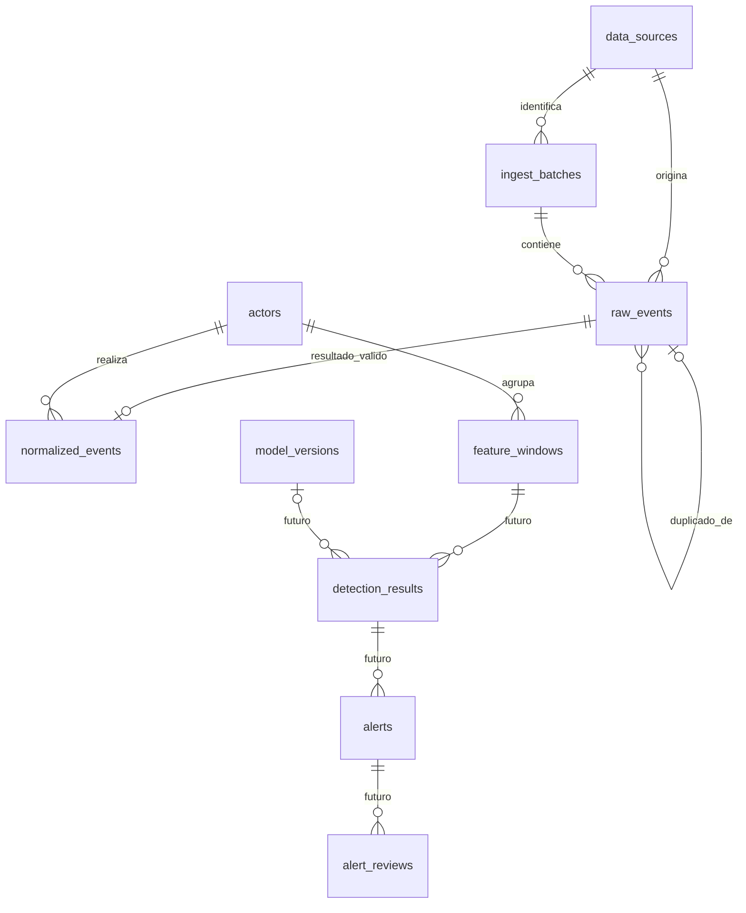

# Base de datos del Sprint 1: diseño y almacenamiento

El prototipo utiliza **PostgreSQL administrado mediante Supabase Cloud**. Supabase no sustituye al motor PostgreSQL: ofrece su administración y herramientas como el Table Editor de la captura. Python accede al motor mediante Psycopg y conexiones privadas con TLS `verify-full`; el visor y el notebook pedagógico funcionan sin conexión.

La empresa del caso de estudio es real, pero los registros de desarrollo son **sintéticos**. Las cantidades siguientes son resultados previamente verificados, no una nueva consulta a la base durante esta publicación. No se publica una copia de PostgreSQL ni sus credenciales.

## 1. Qué aparece en el Table Editor

Hay **diez tablas y una vista**. `active_feature_windows`, identificada con un icono diferente en la captura, es una vista: consulta `feature_windows` filtrando `lifecycle = 'active'`. No es una undécima tabla ni almacena otra copia de las ventanas. Su definición usa `security_invoker`, por lo que conserva la comprobación de permisos del usuario que consulta.

| Objeto | Función | Resultado previo en Sprint 1 |
|---|---|---|
| `data_sources` | Catálogo de fuentes: código, formato y procedencia sintética | 3 fuentes |
| `ingest_batches` | Lote por archivo: fuente, nombre, SHA-256, versión de esquema, conteo y estado | 3 lotes completados |
| `raw_events` | Una fila por ocurrencia original; conserva payload JSONB y procedencia | 20,000 ocurrencias |
| `actors` | Identidad común del trabajador, rol y departamento | 25 trabajadores ficticios |
| `normalized_events` | Resultado válido en columnas homogéneas y referencia a RAW | 19,264 eventos |
| `feature_windows` | Una ventana por trabajador, intervalo y versión; vector y metadatos JSONB | 2,102 ventanas completas |
| `active_feature_windows` — vista | Ventanas cuyo estado de ciclo de vida es activo | 2,102 activas según evidencia previa |
| `model_versions` | Versiones y parámetros del futuro modelo de detección | Sin modelos entrenados |
| `detection_results` | Resultados futuros por ventana: puntuaciones y reglas | Sin predicciones |
| `alerts` | Alertas futuras asociadas a resultados | Sin alertas generadas |
| `alert_reviews` | Revisión y feedback futuros de una alerta | Sin revisiones de alertas |

Las cuatro últimas tablas fueron previstas en el esquema inicial. **Existir en la base no significa que sus funcionalidades estén desarrolladas.** `model_versions` no se utiliza para versionar normalizaciones: son entidades diferentes.

## 2. Relaciones principales



Las claves primarias son UUID. Las claves foráneas impiden referencias a entidades inexistentes. Cada normalizado está asociado a un RAW único mediante `raw_event_id`; cada ventana tiene `actor_id`. No existe una clave foránea directa entre cada evento normalizado y una ventana: una ventana agrega varios eventos seleccionados por trabajador e intervalo y conserva una huella del conjunto de entrada en sus metadatos.

## 3. HU01: cómo se guarda el original

1. Los adaptadores leen las tres fuentes CSV y reconocen encabezados distintos.
2. Se registra la fuente y se crea o recupera su lote mediante fuente, SHA-256 del archivo y versión RAW.
3. Se inserta una ocurrencia en `raw_events` por cada fila lógica del CSV.
4. `payload` conserva los campos originales como JSONB; `external_event_id` conserva el ID de la fuente. `batch_id`, `record_number` y `payload_sha256` permiten identificar origen y contenido.
5. Se registra el estado del lote y sus errores. La carga usa transacciones por archivo; los grupos de 500 filas son unidades de lectura/inserción, no 40 lotes persistidos.

JSONB conserva los valores del registro, pero no representa los bytes originales del CSV ni garantiza el orden de claves. El hash del archivo y su referencia de archivo preservado cubren esa trazabilidad adicional.

La restricción `UNIQUE(batch_id, record_number)` impide duplicar una fila al repetir una carga. **No se exige unicidad global del ID o hash del evento RAW**, porque las copias intencionales deben conservarse. Las 358 ocurrencias duplicadas siguen siendo filas RAW.

## 4. HU02: válidos, cuarentena y duplicados

El normalizador concilia los alias con el directorio sintético, convierte fechas a UTC, tamaños a bytes y operaciones al catálogo común. `actors.actor_code` representa la identidad común; `normalized_events.actor_id` la referencia. Los originales no se sustituyen.

| Estado en `raw_events.processing_status` | Dónde queda el resultado | Cantidad previa |
|---|---|---:|
| `processed` | Una fila correspondiente en `normalized_events` | 19,264 |
| `rejected` | Motivo en `processing_error` e incidencias en `processing_details`; sin normalizado válido | 378 |
| `duplicate` | Referencia `duplicate_of` al canónico; sin normalizado adicional | 358 |

**No hay una tabla independiente de cuarentena.** Se representa en los estados y motivos de RAW. La conciliación es 19,264 + 378 = 19,642 canónicos; más 358 duplicados = 20,000 ocurrencias. Un destino ausente puede quedar como `NULL` con advertencia sin rechazar un evento procesable; no se inventa un destino.

Las restricciones y triggers comprueban la correspondencia entre estado y resultado. Por ejemplo, un RAW procesado debe tener un normalizado y una copia debe apuntar a un canónico compatible. La transacción mantiene conjuntamente estados, referencias e inserciones.

## 5. HU03: cómo se guarda una ventana

`feature_windows` conserva trabajador, `window_start`, `window_end`, `pipeline_version` e información sintética. Sus identificadores son reproducibles; una recarga idéntica no debe producir una ventana nueva.

El campo JSONB `features` contiene tres bloques:

| Bloque | Contenido |
|---|---|
| `vector` | Las once características numéricas aprobadas |
| `metadata` | Partición, cobertura, completitud, aptitud técnica, exposición, versión, contexto, huella de entrada y diagnósticos |
| `audit` | Fechas de creación/cambio, revisión y huella del snapshot |

Ejemplo verificado: EMP002, 7 de septiembre, 14–15 UTC. Seis eventos suman 4,685,954 bytes; seis operaciones/hora, cero fuera de horario y un destino conocido. [Muestra y vector](../../demo/muestras/resultados-verificados.json).

Ventanas UTC de 60 minutos, intervalos `[inicio, fin)`, horarios laborales interpretados en Lima. Las vacías se omiten. Las 2,102 ventanas completas se distribuyen por fecha local: entrenamiento 1–20 (1,334), validación 21–25 (487), prueba 26–30 (281). La marca `model_eligible` indica completitud técnica; no autoriza entrenar con validación o prueba.

## 6. Seguridad y acceso

RLS y permisos mínimos protegen las tablas. La cuenta operativa usa los grupos `pipeline_ingestor`, `pipeline_normalizer` y `pipeline_featurizer` según etapa, sin privilegios administrativos ni BYPASSRLS. Los permisos de actualización están limitados; no autorizan reemplazar payloads RAW ni borrar datos originales.

El rol administrativo se reserva para operaciones expresamente autorizadas. `anon` y `authenticated` no deben tener acceso público indiscriminado. La configuración de exposición de Data API es independiente de que los objetos aparezcan en Table Editor; verlo como administrador no demuestra acceso público. En la configuración previamente reportada las diez tablas estaban deshabilitadas para exposición.

Credenciales y CA permanecen fuera de Git. `.env.example` contiene únicamente valores ficticios. **Clonar el repositorio no da acceso a la base real** ni configura automáticamente sus permisos.

## 7. Scripts y situación de capacidades avanzadas

[Índice SQL](../../scripts/db/README.md): migraciones, verificaciones y reversión están publicados para estudio. Las migraciones 0001–0010 fueron aplicadas según evidencias anteriores. Algunas cabeceras conservan el estado de preparación original; este índice explica el estado posteriormente registrado sin modificar SQL ya aplicado.

0009 agregó campos de revisiones/historial e invalidación y la vista activa; 0010 corrigió un validador. **P18 integral sigue FAIL y P15 integral PARTIAL**, congelados. El error SQL 42725 en la ejecución avanzada permanece conocido. 0011 es una propuesta local NO aplicada, no una corrección validada integralmente. No ejecutar esos escenarios durante la exposición ni presentar el historial avanzado como funcional.

La publicación de scripts no aplica migraciones, no modifica la base y no autoriza ejecutar comandos de escritura.

## 8. Consultas educativas de solo lectura

Estas consultas requieren una conexión y rol autorizados. No son necesarias para el visor o notebook offline y no se ejecutaron durante esta publicación.

```sql
SELECT s.source_code, count(*) AS ocurrencias
FROM public.raw_events r JOIN public.data_sources s ON s.id = r.source_id
GROUP BY s.source_code ORDER BY s.source_code;

SELECT processing_status, count(*) FROM public.raw_events
GROUP BY processing_status ORDER BY processing_status;

SELECT status, count(*) AS lotes, sum(row_count) AS filas
FROM public.ingest_batches GROUP BY status;

SELECT count(*) AS normalizados FROM public.normalized_events;

SELECT features->'metadata'->>'partition' AS particion, count(*) AS ventanas
FROM public.active_feature_windows GROUP BY 1 ORDER BY 1;

SELECT a.actor_code, f.window_start, f.window_end, f.features->'vector' AS vector
FROM public.active_feature_windows f JOIN public.actors a ON a.id = f.actor_id
WHERE a.actor_code = 'EMP002' AND f.window_start = '2026-09-07T14:00:00Z';
```
